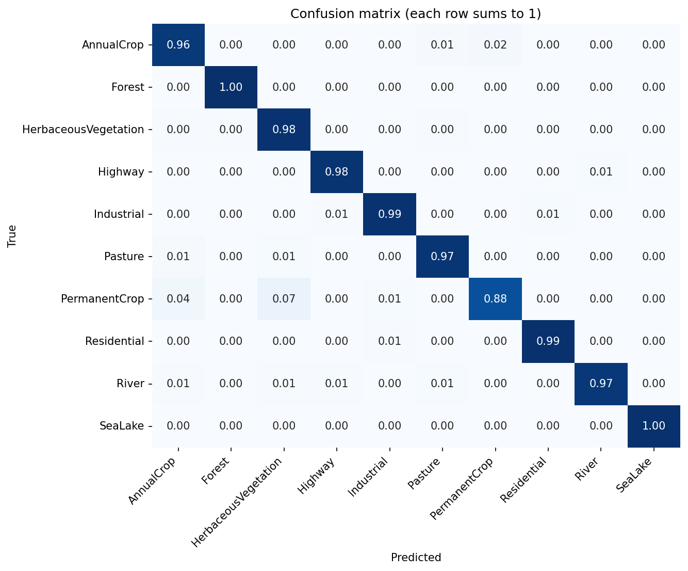
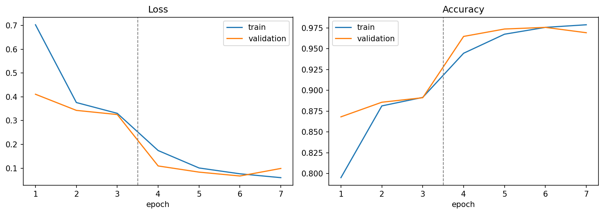
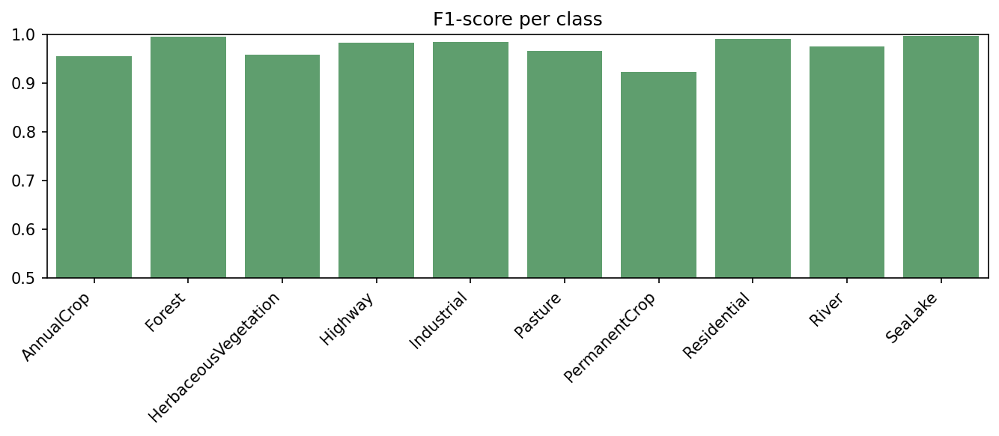
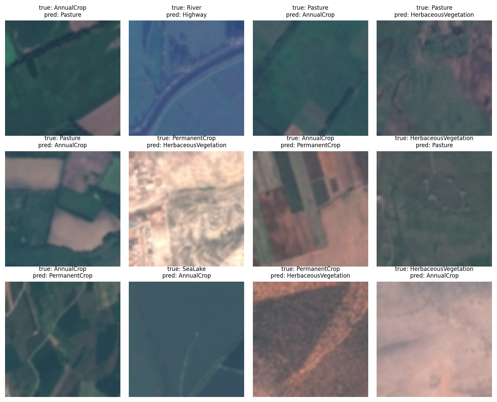

# Satellite Land-Use Classifier using Transfer Learning

Classifies 64x64 satellite images into 10 land-use categories (forest, river, highway, residential, crops, ...) using a **ResNet18 pretrained on ImageNet** and fine-tuned with PyTorch. It reaches **97.4% test accuracy** on 4,050 held-out images.

**Why it matters:** land-use maps are used for urban planning, agriculture monitoring and environmental tracking. Labelling them by hand is slow, so this automates it from imagery.

## Dataset
[EuroSAT](https://github.com/phelber/EuroSAT) (RGB version): 27,000 Sentinel-2 satellite images, 10 classes, about 2,000-3,000 images per class. Downloaded automatically by `torchvision.datasets.EuroSAT`.

## Approach
1. **EDA** - class balance and sample images per class.
2. **Preprocessing / augmentation** - resize to 128px, random horizontal/vertical flips and 90-degree rotations (valid because satellite images have no "up"), ImageNet normalisation.
3. **Stratified split** - 70% train (18,900) / 15% validation (4,050) / 15% test (4,050).
4. **Transfer learning** - replace ResNet18's last layer with a 10-class head, then
   - *Stage 1 (3 epochs):* train only the head with the backbone frozen (Adam, lr 1e-3),
   - *Stage 2 (4 epochs):* unfreeze everything and fine-tune at a 10x lower learning rate (Adam, lr 1e-4).
5. **Model selection** - keep the weights from the epoch with the best validation accuracy.
6. **Evaluation** - test accuracy with a bootstrap 95% confidence interval, per-class precision/recall/F1, confusion matrix and a gallery of misclassified images.

## Results
Trained on a GPU in Google Colab (seed 42). Evaluated once on the held-out test set.

| Metric | Value |
|---|---|
| Test accuracy | **97.4%** (95% CI 96.9% - 97.9%) |
| Macro F1 | **0.973** |
| Best validation accuracy | 97.6% |
| Test images misclassified | about 105 of 4,050 |

**Transfer learning stages (validation accuracy):** training only the new head reached 89.1%; fine-tuning the whole network lifted it to 97.6%.

### Per-class results (test set)
| Class | Precision | Recall | F1 |
|---|---|---|---|
| AnnualCrop | 0.948 | 0.964 | 0.956 |
| Forest | 0.991 | 1.000 | 0.996 |
| HerbaceousVegetation | 0.935 | 0.984 | 0.959 |
| Highway | 0.981 | 0.984 | 0.983 |
| Industrial | 0.981 | 0.987 | 0.984 |
| Pasture | 0.961 | 0.973 | 0.967 |
| PermanentCrop | 0.973 | 0.877 | 0.923 |
| Residential | 0.989 | 0.993 | 0.991 |
| River | 0.984 | 0.968 | 0.976 |
| SeaLake | 1.000 | 0.996 | 0.998 |

### Where the model makes mistakes
| True class | Predicted as | Images |
|---|---|---|
| PermanentCrop | HerbaceousVegetation | 25 |
| PermanentCrop | AnnualCrop | 15 |
| AnnualCrop | PermanentCrop | 9 |
| AnnualCrop | Pasture | 6 |
| River | Highway | 4 |

- **Strongest classes:** SeaLake (F1 0.998), Forest (0.996) and Residential (0.991) have distinctive colours and textures.
- **Weakest class:** PermanentCrop (F1 0.923, recall 0.877). It is often confused with other vegetation and crop classes that look alike from above.
- **River vs Highway:** both are long thin features, so a few get mixed up.

### Figures





More in `outputs/`: `class_distribution.png`, `sample_images.png`, and all numbers in `metrics.json`.

## How to run
**Google Colab (easiest):** upload `landuse_classifier.ipynb`, choose `Runtime -> Change runtime type -> T4 GPU`, then `Runtime -> Run all`.

**Locally:**
```bash
pip install -r requirements.txt
python train.py                      # trains and writes everything to outputs/
python predict.py some_image.jpg     # classify one image with the trained model
```
A GPU is strongly recommended; on a CPU training takes much longer. To check the code works without downloading anything (tiny fake dataset, meaningless results): `SMOKE_TEST=1 python train.py`.

## Project structure
```
landuse_classifier.ipynb   # explained, step-by-step notebook (main deliverable)
train.py                   # same code as a script
predict.py                 # single-image inference
requirements.txt
outputs/                   # metrics.json and result figures
```
The trained weights (`model.pt`) are not stored in the repo; run the notebook or `train.py` to produce them.

## Tech stack
Python, PyTorch, torchvision, scikit-learn, NumPy, Matplotlib, Seaborn.

## Limitations and next steps
- Images are small (64x64) and from one satellite, so the model may not transfer to other sensors or resolutions without retraining.
- The crop and vegetation classes are the hardest to tell apart; multispectral bands (not just RGB) would likely help.
- Validation accuracy peaked at the third fine-tuning epoch and dipped slightly after, so selecting the best epoch on validation mattered.
- Ideas: a bigger backbone (ResNet50, EfficientNet), class-weighted loss, Grad-CAM to see what the model looks at, and a Streamlit upload demo.
